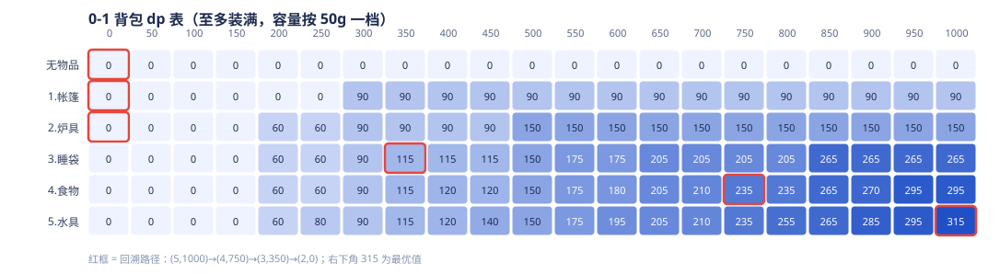

# 《人工智能程序设计与实践》实践报告六：贪心与动态规划

## 一、个人信息

| 项目 | 内容 |
|---|---|
| 姓名 | 李红颖 |
| 学号 | 20251030168 |
| 学院／专业 | 经济学院 金融计算机双学位班 |
| 课程／课次 | 人工智能程序设计与实践 · 第 6 次课（贪心与动态规划 × 用 AI 开发程序） |
| 完成日期 | 2026-10-29 |
| 开发环境 | Windows 11、Python 3.14.7、PowerShell、TRAE |
| 作业仓库 | `lesson06-dp`（本地目录 `报告六/`，git 初始化与 push 由本人完成） |
| 对应材料 | 实践指南六、课堂作业六、课件站 a6 |

## 二、作业任务与完成总览

| 层级 | 任务 | 分值 | 完成情况 | 证据 |
|---|---|---|---|---|
| 案例复现 | Step1 凑硬币（贪心 vs 动规） | 15 | 完成 | `results/step1_coin.txt`；贪心 5 枚、动规 3 枚 |
| 案例复现 | Step2 0-1 背包 + 回溯组合 | 20 | 完成 | `results/step2_knapsack.txt`；315、`[3,4,5]` |
| 提交规范 | 独立仓库 + 提交说明 | 5 | 文件就绪，git 由本人执行 | `README.md` 中的命令 |
| 自主实践 | ① 容量改 800 对比并解释 | 10 | 完成 | 动规 315→255；贪心 800g 恰好最优、1000g 不最优 |
| 自主实践 | ② 背包加“必投项目”约束 | 10 | 完成 | 必投帐篷 290 / 睡袋 315 / 炉具 295；200g 无解 |
| 自主实践 | ③ 贴 dp 最后一行 + 标回溯路径 | 20 | 完成 | 本报告 4.3–4.4；`images/dp_heatmap.svg` |
| 自主实践 | ④ AI 使用记录（四问格式） | 10 | 完成 | 本报告 5.3；`progress.md` 第 5 节 |
| 独立研究 | n-皇后 / 完全背包 / 分支限界 | 20 | 完成 | `code/research/` 三个脚本与输出 |
| 选做 | dp 热力图 | — | 完成留档 | `images/dp_heatmap.svg` |

检查点汇总：**贪心 5 枚 vs 动规 3 枚；背包最优 315、组合 [3,4,5]**，均以程序输出为准，并另用 2⁵ 穷举交叉核对。

## 三、案例复现 Step1：凑硬币

### 3.1 问题

面额 `[1, 5, 11]`，凑出 15 元，分别用贪心与动态规划求最少硬币枚数及具体组合：

- 贪心：每一步都取“不超过余额的最大面额”，拿到拿不动为止，不回头。
- 动规：`dp[c]` 表示凑出 `c` 元的最少枚数，地基 `dp[0] = 0`，从小往大填表。

### 3.2 核心代码与递推

```python
def coin_greedy(coins, amount):
    remain, combo = amount, []
    for c in sorted(coins, reverse=True):   # 从大到小
        while remain >= c:                  # 能拿就拿
            combo.append(c); remain -= c
    return (len(combo), combo) if remain == 0 else (None, None)

def coin_dp(coins, amount):
    dp = [INF] * (amount + 1); dp[0] = 0
    choice = [-1] * (amount + 1)
    for c in range(1, amount + 1):
        for coin in coins:
            if c >= coin and dp[c - coin] + 1 < dp[c]:
                dp[c] = dp[c - coin] + 1     # ← 本题心脏一行
                choice[c] = coin
    # 再沿 choice 回溯出组合
```

递推式：

```text
dp[c] = 1 + min(dp[c - 1], dp[c - 5], dp[c - 11])      （只对 c ≥ 对应面额）
```

### 3.3 填表过程（c = 0…15）

| c | 0 | 1 | 2 | 3 | 4 | 5 | 6 | 7 | 8 | 9 | 10 | 11 | 12 | 13 | 14 | 15 |
|---|---|---|---|---|---|---|---|---|---|---|---|---|---|---|---|---|
| dp[c] | 0 | 1 | 2 | 3 | 4 | 1 | 2 | 3 | 4 | 5 | 2 | 1 | 2 | 3 | 4 | **3** |

`dp[15] = 1 + min(dp[14], dp[10], dp[4]) = 1 + min(4, 2, 4) = 3`，最后一枚取 5，即 `5 + 5 + 5`。

### 3.4 实际运行结果

```text
面额 [1, 5, 11]，金额 15
贪心：5 枚  →  11+1+1+1+1 = 15
动规：3 枚  →  5+5+5 = 15
dp[c] 填表（c=0..15）：[0, 1, 2, 3, 4, 1, 2, 3, 4, 5, 2, 1, 2, 3, 4, 3]
检查点（贪心 5 枚、动规 3 枚）：通过
```

### 3.5 讨论：贪心为什么翻车

第一步取 11 在局部看最赚，却把余额逼进 4 元的死局，只能再用四枚 1 元，共 5 枚；最优解 `5+5+5` 每一步单看都不如取 11，三步加起来却是全局最优。本题不满足“贪心选择性质”，因此贪心可以快但不保证对；要证明“局部最优能推出全局最优”才能持证上岗。

## 四、案例复现 Step2：0-1 背包

### 4.1 题目与两条约定

五件物品，限重 1000g，每件要么带、要么不带：

| 编号（1 基） | 物品 | 重量 g | 重要度 |
|---|---|---|---|
| 1 | 帐篷 | 300 | 90 |
| 2 | 炉具 | 200 | 60 |
| 3 | 睡袋 | 350 | 115 |
| 4 | 食物 | 400 | 120 |
| 5 | 水具 | 250 | 80 |

- **变体：至多装满**。容量可以不花完，`dp` 初值全为 0。若用“恰好装满”，初值应为 −∞（除 `dp[*][0]=0`）；例如容量 150g 时至多装满为 0，恰好装满则无解。本报告统一用至多装满。
- **容量档位：50g**。五件物品重量都是 50 的倍数，用 50g 一档（共 20 档）与逐克计算完全等价，但表格更紧凑。指南示意表按 100g 一档，350、250 不是 100 的倍数，直接取整会失真，因此没有照搬。

### 4.2 递推式与“心脏一行”

```text
dp[i][c] = max( dp[i-1][c],                    # 不带第 i 件
                dp[i-1][c-w[i]] + v[i] )       # 带（前提 c ≥ w[i]）
```

```python
for i in range(1, n + 1):
    for c in range(C + 1):
        dp[i][c] = dp[i - 1][c]                                  # 不带
        if c >= w[i - 1] and dp[i - 1][c - w[i - 1]] + v[i - 1] > dp[i][c]:
            dp[i][c] = dp[i - 1][c - w[i - 1]] + v[i - 1]        # 带
```

### 4.3 完整 dp 表与最后一行

行 = 前 i 件物品，列 = 容量（每 50g 一档）：

| 前 i 件 \ 容量g | 0 | 50 | 100 | 150 | 200 | 250 | 300 | 350 | 400 | 450 | 500 | 550 | 600 | 650 | 700 | 750 | 800 | 850 | 900 | 950 | 1000 |
|---|---|---|---|---|---|---|---|---|---|---|---|---|---|---|---|---|---|---|---|---|---|
| 0 无物品 | 0 | 0 | 0 | 0 | 0 | 0 | 0 | 0 | 0 | 0 | 0 | 0 | 0 | 0 | 0 | 0 | 0 | 0 | 0 | 0 | 0 |
| 1 帐篷 | 0 | 0 | 0 | 0 | 0 | 0 | 90 | 90 | 90 | 90 | 90 | 90 | 90 | 90 | 90 | 90 | 90 | 90 | 90 | 90 | 90 |
| 2 炉具 | 0 | 0 | 0 | 0 | 60 | 60 | 90 | 90 | 90 | 90 | 150 | 150 | 150 | 150 | 150 | 150 | 150 | 150 | 150 | 150 | 150 |
| 3 睡袋 | 0 | 0 | 0 | 0 | 60 | 60 | 90 | 115 | 115 | 115 | 150 | 175 | 175 | 205 | 205 | 205 | 205 | 265 | 265 | 265 | 265 |
| 4 食物 | 0 | 0 | 0 | 0 | 60 | 60 | 90 | 115 | 120 | 120 | 150 | 175 | 180 | 205 | 210 | 235 | 235 | 265 | 270 | 295 | 295 |
| **5 水具（最后一行）** | 0 | 0 | 0 | 0 | 60 | 80 | 90 | 115 | 120 | 140 | 150 | 175 | 195 | 205 | 210 | 235 | 255 | 265 | 285 | 295 | **315** |

最后一行即“前 5 件、各容量下的最优重要度”，右下角 `dp[5][1000] = 315`。



### 4.4 回溯路径（对应自主实践③）

从 `dp[5][1000]` 出发：本格 = 正上方 → 没带第 i 件，往上走；本格 ≠ 正上方 → 带了第 i 件，扣掉它的重量后往左上走。

| 步骤 | 当前格子 | 本格值 | 正上方 | 判断 | 动作 | 新容量 |
|---|---|---|---|---|---|---|
| 1 | dp[5][1000g] | 315 | dp[4][1000g] = 295 | 315 > 295 | 带上 5.水具 | 750g |
| 2 | dp[4][750g] | 235 | dp[3][750g] = 205 | 235 > 205 | 带上 4.食物 | 350g |
| 3 | dp[3][350g] | 115 | dp[2][350g] = 90 | 115 > 90 | 带上 3.睡袋 | 0g |
| 4 | dp[2][0g] | 0 | dp[1][0g] = 0 | 相等 | 跳过 2.炉具 | 0g |
| 5 | dp[1][0g] | 0 | dp[0][0g] = 0 | 相等 | 跳过 1.帐篷 | 0g |
| 6 | dp[0][0g] | 0 | — | 到达地基 | 结束 | — |

回溯得到 **0 基 `[2,3,4]`、1 基 `[3,4,5]`**，即 **睡袋 + 食物 + 水具**，重量 350+400+250 = 1000g，重要度 115+120+80 = **315**。

### 4.5 验证与复杂度

- 穷举 2⁵ = 32 种组合独立核对：最优 315、组合 `[2,3,4]`，与 dp 完全一致。
- 时间复杂度 `O(n·C)`（本题 n=5、C=20 档）；空间 `O(n·C)`，若只保留上一行可优化到 `O(C)`，但为了回溯组合与贴表，本实现保留完整表。
- 贪心对照：按性价比装，1000g 下只得到 255（炉具+睡袋+水具，800g），低于最优 315，说明本题贪心不保最优。

## 五、自主实践

### 5.1 预算从 1000g 改成 800g 的对比

| 容量 | 动规最优 | 动规组合 | 贪心（性价比） | 贪心是否最优 |
|---|---|---|---|---|
| 1000g | **315** | 睡袋+食物+水具（1000g） | 255（炉具+睡袋+水具，800g） | 否 |
| 800g | **255** | 炉具+睡袋+水具（800g） | 255（同一组合） | 是（碰巧） |

解释：原来能放下的 `睡袋350 + 食物400 + 水具250` 恰好占满 1000g；容量只剩 800g 时，400g 的食物无法再与 350g 的睡袋同时放下，只能换成 `炉具200 + 睡袋350 + 水具250 = 800g`，重要度 60+115+80 = 255，比 315 少 60。800g 时贪心恰好也得到 255，与最优相同；但回到 1000g，贪心只有 255，低于 315——**贪心“这次碰巧对”不等于“永远对”**。

### 5.2 加“必投项目”约束

做法：先无条件扣除必投物品的重量与价值，再在剩余物品、剩余容量上照常跑 0-1 背包，最后把必投物品加回组合。

| 情形 | 最优重要度 | 组合 | 重量 | 与无约束 315 对比 |
|---|---|---|---|---|
| 无约束 | 315 | 睡袋+食物+水具 | 1000g | — |
| 必投 帐篷 | **290** | 帐篷+食物+水具 | 950g | −25 |
| 必投 睡袋 | **315** | 睡袋+食物+水具 | 1000g | 不变（本来就在最优组合里） |
| 必投 炉具 | **295** | 炉具+睡袋+食物 | 950g | −20 |
| 必投 帐篷、限重 200g | 无解 | — | — | 必投物品本身就超重 |

每种情形都用 `brute_force(..., required=...)` 穷举核对，结果全部一致。结论：必投约束把“可选题”变成“必选题”，先占用一份重量，剩余容量变小，原最优组合可能被挤掉；若必投物品已在最优组合中，则最优值不变。

### 5.3 AI 使用记录（四问格式）

| 四问要素 | 关键指令原文 | 我的验证 |
|---|---|---|
| 角色 | 你是有经验的 Python 算法工程师；我是 Python 初学者，正在完成课堂实验。 | — |
| 背景 | 面额 `[1,5,11]` 凑 15；检查点贪心 5 枚、动规 3 枚；背包五件物品、限重 1000g、统一至多装满。 | 与指南六、作业单页逐条对照 |
| 任务 | 实现 `coin_greedy`/`coin_dp` 并打印对比与填表；实现 0-1 背包并打印完整 dp 表、最后一行、回溯组合；再做 800g 对比、必投约束与三个独立研究。 | 运行 7 个脚本，见 `results/` |
| 约束 | 中文注释、单文件、不装第三方库；答案以程序输出为准；每组结果另用穷举核对；容量档位按物品重量公约数取 50g。 | 逐项核对：5 vs 3、315/[3,4,5]、800→255、必投 290/315/295、n=4→2、n=8→92、完全背包 320、分支限界 14 节点 |

完整的三条指令原文与逐步验证见 `progress.md` 第 5 节。

### 5.4 选做：dp 热力图

`images/dp_heatmap.svg` 用颜色深浅表示 dp 值大小，红框标出回溯路径 `(5,1000)→(4,750)→(3,350)→(2,0)`，右下角 315 为最优值，留作展示素材。

## 六、独立研究

### 6.1 回溯法：n-皇后问题

**问题**：在 n×n 棋盘放 n 个皇后，任意两个不在同一行、同一列、同一条斜线，求方案数或一种方案。

**做法**：按行递归，每行尝试 n 个列；用三个集合 O(1) 判冲突——已占列 `c`、主对角线 `r-c`、副对角线 `r+c`；放不下就撤销选择、退回上一行（回溯）。

**与动规穷举的不同**：n-皇后是约束满足／计数问题，没有可最大化的目标值；第 i 行的可行位置依赖前面所有皇后的具体摆法，状态无法压缩成 dp 表，子问题也不重叠，因此**不能用动规**。回溯仍是穷举，但会提前砍掉不可行的前缀；最坏仍是指数级（约 n! 量级）。

**验证**：n=4 得 2 解并打印棋盘，n=8 得 92 解，与已知结论一致。

### 6.2 完全背包：改哪一行

```text
0-1 背包：dp[i][c] = max(dp[i-1][c], dp[i-1][c-w[i]] + v[i])
完全背包：dp[i][c] = max(dp[i-1][c], dp[i]  [c-w[i]] + v[i])
                                      ↑ 从“本行”取，而不是“上一行”
```

一维写法：0-1 背包容量**递减**遍历，完全背包容量**递增**遍历。本题 1000g 下，0-1 最优 315；完全背包可拿 **2 个睡袋 + 1 个帐篷 = 2×115+90 = 320**，程序输出已验证。

### 6.3 分支限界

**一句话**：分支限界 = 回溯 + 上界剪枝 + 优先扩展最有希望的节点。

**比回溯好在哪**：回溯只判可行、盲目深度优先；分支限界用“剩余容量按性价比装满”的小数解算上界，若上界都超不过当前最优就整枝砍掉。本题最优仍是 315，只访问 **14 个节点**，少于全枚举的 32 个叶子。代价是要计算上界、维护优先队列，且只适合有优化目标的问题；纯可行性问题（如 n-皇后）没有“上界”可用，优势不明显。

## 七、遇到的问题与解决

| 问题 | 原因 | 解决方式 | 结果 |
|---|---|---|---|
| 指南表按 100g 一档，350/250 不是 100 的倍数 | 直接取整会改变物品重量，组合与最优值可能出错 | 取五件物品重量的公约数 50g 为一档，共 20 档；再用 2⁵ 穷举核对 | 315 与穷举一致，精度无损 |
| 必投约束若只加价值、不扣重量 | 会得到超过 1000g 的假最优 | 先扣必投物品重量与价值，在剩余容量上跑背包，再加回组合 | 四种情形均与穷举一致 |
| `step2_knapsack.py` 运行报 `SyntaxError: '(' was never closed` | 打印最后一行时外层 `print` 的右括号漏写 | 按报错行号定位并补齐括号，重新运行 | 输出完整 dp 表与回溯路径 |
| 容量 800g 时贪心恰好等于最优，容易误以为贪心总对 | 单一容量下的巧合 | 补做 1000g 对照：贪心 255 < 动规 315 | 明确“贪心不保最优，要看结构” |

## 八、提交清单与复现命令

```text
报告六/
├── README.md
├── progress.md
├── 20251030168_李红颖_贪心与动态规划实验报告.md
├── code/  step1_coin.py  knapsack.py  step2_knapsack.py
│          step3_budget_compare.py  step4_required_item.py
│          research/n_queens.py  research/complete_knapsack.py  research/branch_bound.py
├── results/  7 个脚本的真实运行输出
└── images/dp_heatmap.svg
```

在 `code/` 目录下复现：

```sh
python step1_coin.py
python step2_knapsack.py
python step3_budget_compare.py
python step4_required_item.py
python research/n_queens.py
python research/complete_knapsack.py
python research/branch_bound.py
```

Git 初始化与 push 由本人执行，命令见 `README.md`。

## 九、心得体会

1. **贪心与动规的分界线是“结构”而不是“聪明”**：{1,5,11} 凑 15 只用改一个数字，贪心就从 2 枚的最优跌到 5 枚；而背包里“按性价比”在 800g 碰巧最优、在 1000g 就输给动规。能不能用贪心，必须先证明贪心选择性质。
2. **动规的胜利来自“算过就存”**：把指数级的重复子问题压成一张 `O(n·C)` 的表，代价是多花空间与填表时间，换来全局最优的保证。背包的整张表其实只在回答一个问题：前 i 件、容量 c 时，带还是不带。
3. **验收比生成更重要**：AI 很快给出代码，但 315 这个数字必须自己用穷举、用回溯路径、用手算三方对上；容量档位、至多/恰好装满这些“小约定”一旦含糊，答案就会悄悄变错。这正是“看得懂、验得动”才是真本事。
